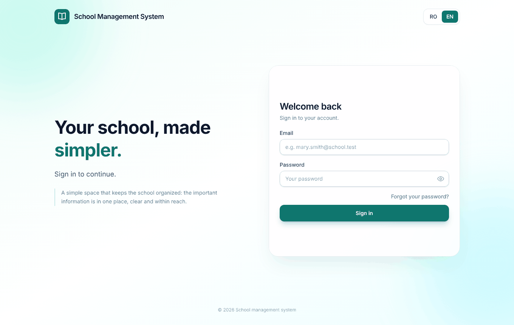
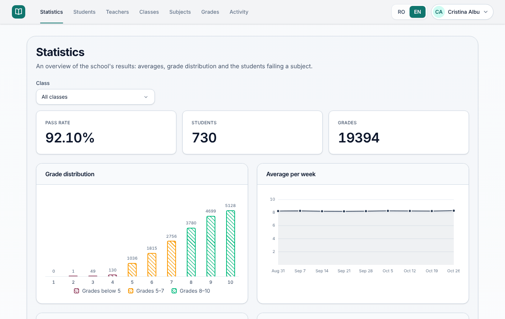
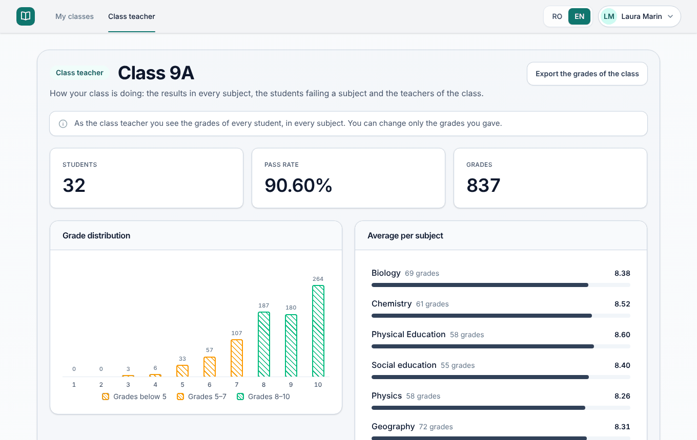
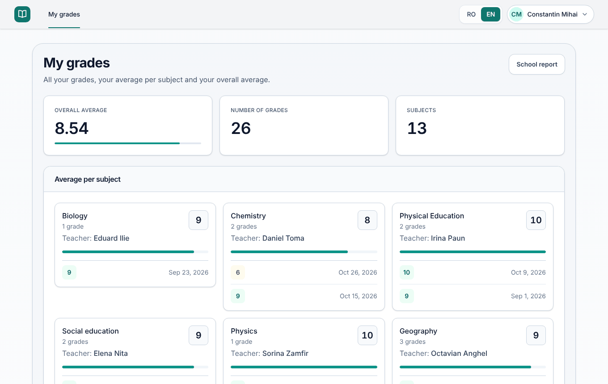

# School Management System

A web application for running a school: students, teachers, classes, subjects
and grades. People sign in with an email and a password, and each role (administrator,
teacher, student) sees and can change only what it is allowed to. The rules are
enforced by the backend, not only hidden in the interface.

The project was built as a full stack exercise: a NestJS API on MySQL, a React
frontend, and everything needed to run it with one command.

<p align="center">
  
  
</p>
<p align="center">
  
  
</p>

## Contents

- [Features](#features)
- [Tech stack](#tech-stack)
- [Quick start](#quick-start)
- [Test accounts](#test-accounts)
- [Run for development](#run-for-development)
- [Configuration](#configuration)
- [API](#api)
- [Roles and permissions](#roles-and-permissions)
- [Project structure](#project-structure)
- [Testing and CI](#testing-and-ci)
- [Design decisions](#design-decisions)
- [Troubleshooting](#troubleshooting)
- [Known limitations](#known-limitations)

## Features

**Administrator**

- Manages students, teachers, classes, subjects and grades.
- Chooses the class teacher of each class, puts students in classes, and says
  which teacher teaches which subject in which class.
- Imports students, teachers, classes and subjects from a CSV file. The file is
  checked and shown first, and nothing is saved until the administrator confirms.
- Follows the results of the school: pass rate, grade distribution, averages and
  the students who are failing a subject.
- Sees the history of every grade change, and exports grades as CSV.

**Teacher**

- Sees the classes where they teach and grades the students in their own subjects.
- The class teacher also sees the whole class: how it is doing, who is failing,
  every student with all their grades, and a school report to print.

**Student**

- Sees their profile, class, grades, the average of each subject, the teacher of
  each subject and a school report to print.

**Everyone**

- The interface is in Romanian and in English.
- Password change, and password reset by email.

## Tech stack

| Part | Technology |
|---|---|
| Backend | NestJS 12 (TypeScript), Prisma 7 |
| Database | MySQL 8.4, and Redis 7 as an optional cache |
| Frontend | React 19, Vite, Tailwind CSS, TanStack Query, i18next |
| Authentication | JWT, bcrypt, role-based access control |
| API documentation | Swagger and a Postman collection |
| Tooling | Docker Compose, GitHub Actions, Vitest, oxlint, Prettier |

## Quick start

The simplest way to run the application is with Docker. You do not need to
install Node.js or MySQL.

**Before you start:** install [Docker](https://docs.docker.com/get-docker/). On
Windows or Mac, open Docker Desktop and wait until it says it is running.

**1. Clone the project and go into the folder**

```bash
git clone https://github.com/AlexGhiarasim/school-management-system.git
cd school-management-system
```

**2. Create the settings file.** The default values work as they are.

```bash
cp .env.example .env
```

On Windows PowerShell, use `copy .env.example .env` instead.

**3. Start the application**

```bash
docker compose up --build
```

The first start takes a few minutes, because it builds the images, creates the
database and loads the sample data. It is ready when the logs stop moving.

**4. Open the application**

Go to http://localhost:8080 and sign in with a [test account](#test-accounts),
for example `admin@school.test` with the password `Admin123!`.

Other addresses:

| What | Address |
|---|---|
| API documentation (Swagger) | http://localhost:8080/api/docs |
| Emails sent by the application (Mailpit) | http://localhost:8025 |

**Stopping**

Press `Ctrl+C` in the terminal, then run:

```bash
docker compose down
```

To delete the database too, so the next start begins with fresh sample data, run
`docker compose down -v`.

Change `JWT_SECRET` in `.env` before using the stack for anything other than a
demo.

## Test accounts

The sample data is a high school with 24 classes (9A to 12F), 730 students (and 4
without a class), 46 teachers, 16 subjects and about 19,400 grades. It is the
same every time you create it.

| Role | Email | Password |
|---|---|---|
| Administrator | `admin@school.test` | `Admin123!` |
| Teacher and class teacher of 9A | `laura.marin@school.test` | `Teacher123!` |
| Student in 9A | `mihai.constantin@student.school.test` | `Student123!` |

There is also a second administrator, `admin2@school.test`. All teachers share
one password, and all students share another. Teachers use the `@school.test`
address and students use `@student.school.test`. Phone numbers are made up, from
a range reserved for fiction.

**What to try**

- As the administrator, open **Statistics**, then **Classes**, then a class, to
  see its students and its teachers. The students, teachers, classes and
  subjects sections each have an **Import from a file** button.
- As Laura Marin, open **Class teacher** for the page of class 9A, and **My
  classes** to grade the students of the classes where she teaches.
- As Mihai Constantin, open **My grades** and then **School report**.

## Run for development

Use this if you want to change the code. You need Node.js 24, npm and Docker.

**1. Create the settings file**

```bash
cp .env.example .env
```

**2. Start MySQL, Redis and Mailpit** (Mailpit shows the emails the application
sends, at http://localhost:8025)

```bash
docker compose up -d mysql redis mailpit
```

**3. Start the backend**

```bash
cd backend
npm install
npm run prisma:deploy
npm run prisma:seed
npm run start:dev
```

`prisma:deploy` creates the tables and `prisma:seed` loads the sample data. You
can run the seed again at any time to start over.

**4. Start the frontend**, in a second terminal

```bash
cd frontend
npm install
npm run dev
```

| What | Address |
|---|---|
| Frontend | http://localhost:5173 |
| API | http://localhost:3000/api |
| Swagger | http://localhost:3000/api/docs |

In Swagger, press **Authorize** and paste the token returned by
`POST /api/auth/login`. If the API runs somewhere else, set `VITE_API_URL` (see
`frontend/.env.example`).

## Configuration

The settings are read from `.env`, and `.env.example` lists all of them.

| Variable | What it does | Default |
|---|---|---|
| `DATABASE_URL` | Connection to MySQL, for development | the local container |
| `REDIS_URL` | Address of the cache. Remove the line to run without Redis | the local container |
| `JWT_SECRET` | The secret that signs the tokens, 32 characters or more | set in `.env.example` |
| `JWT_EXPIRES_IN` | How long a token is valid | `730d` |
| `CORS_ORIGIN` | The frontend address the API accepts | `http://localhost:5173` |
| `ALLOW_PUBLIC_REGISTRATION` | Lets anyone create a student account | `false` |
| `SMTP_HOST`, `SMTP_PORT`, `SMTP_USER`, `SMTP_PASSWORD`, `MAIL_FROM`, `APP_URL` | A real mail server for password resets. Without them, emails go to Mailpit | Mailpit |
| `FRONTEND_PORT`, `BACKEND_PORT`, `MYSQL_PORT` | Ports used by Docker Compose | `8080`, `3000`, `3306` |

## API

All endpoints are under `/api`. Lists accept `page` and `limit`, and answer with
`{ data, meta }`. The full list, with the request and response formats, is in
Swagger.

A [Postman collection](docs/postman/School-Management-System.postman_collection.json)
covers every endpoint. Import it, send one of the "Login as" requests, then any
other request. After the API changes, run `npm run postman` in `backend` to build
the collection again.

| Area | Endpoints |
|---|---|
| Authentication | `POST /auth/login`, `POST /auth/register` (when enabled), `POST /auth/forgot-password`, `POST /auth/reset-password`, `POST /auth/change-password`, `GET /auth/me`, `GET /auth/config` |
| People | `/students`, `/teachers`, `/admins`, `GET /students/me`, `GET /teachers/me/classes` |
| Classes | `/classes`, `PATCH /classes/:id/teacher`, `GET /classes/:id/students`, `/classes/:id/teaching`, `GET /classes/:id/overview` |
| Subjects | `/subjects` |
| Grades | `/grades`, `GET /grades/me`, `GET /grades/export`, `GET /grades/history`, `GET /grades/:id/history` |
| Statistics | `GET /statistics` |
| Import | `GET /imports/:kind/template`, `POST /imports/:kind/preview`, `POST /imports/:kind` |
| Health | `GET /health` |

## Roles and permissions

| Action | Administrator | Teacher | Student |
|---|---|---|---|
| Create, edit and delete students, teachers, classes and subjects | yes | no | no |
| Read the subjects | yes | yes | yes |
| See the students of a class | yes | own classes | no |
| See grades | all | own subjects, and the whole class for the class teacher | own grades |
| Add a grade | yes | own subjects in own classes | no |
| Edit a grade | yes | grades they gave | no |
| Delete a grade | yes | no | no |
| Class overview and grade export | yes | class teacher, own class | no |
| Statistics, grade history and import | yes | no | no |

The rules behind the table:

- A teacher teaches a subject in a class (a `TeachingAssignment`), and can see and
  grade only those subjects, for the students of those classes. A new teacher has
  nothing to grade until an administrator gives them a subject.
- The class teacher (`Class.teacherId`) also sees every grade of the class, but
  can change only the grades they gave.
- The identity of a student or a teacher always comes from the token, never from
  the address of the request.

## Project structure

```
backend/
  prisma/            Database schema, migrations and the seed script
  src/
    common/          Decorators, guards, filters and helpers
    config/          Validation of the settings
    cache/           Redis cache
    database/        Prisma service
    modules/         auth, health, subjects, teachers, classes, students,
                     grades, statistics, imports
  test/              End-to-end tests
frontend/
  src/
    features/        Components for each role, statistics and sign-in
    pages/           One file for each screen
    routes/          Routing and role guards
    services/        API client
    locales/         Romanian and English texts
docker/              Database initialization
docs/                Architecture diagrams, screenshots and Postman collection
```

The [architecture page](docs/architecture.md) shows how the parts connect and the
database diagram. The backend has its own [notes on the source layout](backend/README.md).

## Testing and CI

```bash
cd backend
npm test             # unit tests
npm run test:e2e     # end-to-end tests, MySQL and Redis must be running

cd frontend
npm test
```

- The unit tests cover the authorization, grading, statistics and import rules.
- The end-to-end tests start the real application against MySQL and check
  authentication, the restrictions of each role and the main flows. They create
  their own data and remove it afterwards.
- The frontend tests cover form validation, the role guards on every route, the
  API client and the main pages.
- GitHub Actions checks every pull request: lint, build, tests and migrations for
  the backend and the frontend, and a third workflow builds the Docker images.

## Design decisions

- **Prisma and MySQL.** The schema is the single source of truth, and the client
  is fully typed. Migrations are versioned, and a database constraint keeps grade
  values between 1 and 10.
- **One `User` table for sign-in.** Administrators, teachers and students are
  profiles linked to a user. Deleting a profile deletes its account.
- **Averages.** The average of a subject is rounded to a whole number (6.5
  becomes 7), and the overall average is the mean of those rounded averages. A
  student is failing a subject when its rounded average is below 5.
- **Tokens.** A token is valid for two years (`JWT_EXPIRES_IN`), and the browser
  keeps it in local storage. There are no refresh tokens. A deactivated account
  loses access at once, because the token is checked against the database on
  every request. Changing a password signs out every other session.
- **Password reset.** The emailed link carries a random token. Only its SHA-256
  hash is stored, it expires after 60 minutes and it works once. The request
  always answers 204, so it never reveals which emails have an account.
- **Public registration is off by default.** Accounts come from the seed script
  and from administrators. The student sign-up stays in the code, behind
  `ALLOW_PUBLIC_REGISTRATION`.
- **Cache.** Statistics and class overviews add up thousands of grades, so Redis
  keeps the result for five minutes (about 120 ms without it and 9 ms with it, on
  the sample data). Each key carries a version number, and any successful change
  raises it, which makes the older entries unreachable at once. Who may see a
  class is always read from the database. The application works without Redis.
- **Grade history.** Every grade that is added, changed or deleted writes an entry
  to `GradeAudit` in the same transaction, with who made the change and the
  values before and after. The entry keeps copies of the names of the student and
  the subject, so it still reads correctly after they are deleted.
- **Import from a file.** The CSV can use `;` or `,`, UTF-8 or Windows-1250, and
  Romanian or English headers. Each row is checked with the same rules as the
  forms, and the rows with errors are skipped. The other rows are saved in one
  transaction. A new account without a password in the file gets a generated one,
  shown once so it can be downloaded. A file has 200 rows at most, because each
  account costs about 0.1 seconds of password hashing.
- **Exports.** The CSV starts with a byte order mark so that Excel shows the
  diacritics, uses `;` in Romanian and `,` in English, and escapes values that a
  spreadsheet would run as formulas. The school report is a page laid out for
  printing, so the browser can save it as a PDF without an extra library.
- **Input validation.** Names accept letters, spaces, hyphens and apostrophes.
  Passwords need 8 to 72 characters, with at least a letter and a digit. Unknown
  fields are rejected, and the frontend applies the same rules before it sends a
  form.
- **Rate limiting.** Sign-in is limited to 5 attempts per minute, and the rest of
  the API to 100 requests per minute.

## Troubleshooting

- **`docker compose` says it cannot connect to Docker.** Docker Desktop is not
  running. Start it and wait until it is ready.
- **A port is already in use.** Change `FRONTEND_PORT`, `BACKEND_PORT` or
  `MYSQL_PORT` in `.env`, then start again.
- **The page does not open after the first start.** The build may still be
  running. Wait until `docker compose ps` shows the backend as healthy. If it does
  not, run `docker compose logs backend --tail 60` and read the last lines.
- **You want to start over with fresh data.** Run `docker compose down -v`, then
  `docker compose up --build`. In development, run `npm run prisma:seed` instead.
- **"Too many requests" when signing in.** Sign-in is limited to 5 attempts per
  minute. Wait a minute and try again.
- **A password reset email does not arrive.** Without a mail server configured,
  emails are not sent to a real inbox. Open http://localhost:8025 to read them.

## Known limitations

- Tokens last two years and are stored in local storage. For a real deployment,
  use short-lived tokens with a refresh token.
- The Docker Compose file is meant for running the project on your own machine.
  Its ports are open only to `localhost`, the passwords in `.env.example` are
  examples, and the sample accounts have public passwords. Do not put it on a
  public server as it is.
- There is no file or photo upload, and no school calendar or attendance.
