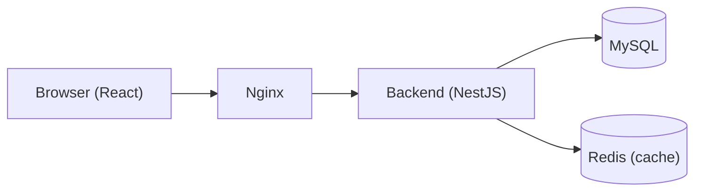
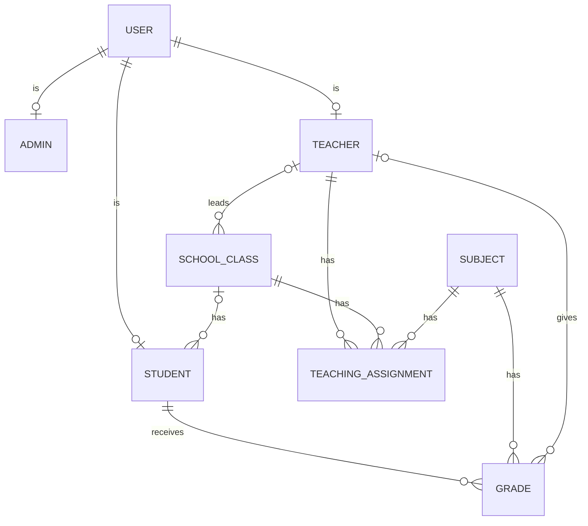

# Architecture

GitHub draws the diagrams below on its own.

## How the parts connect

In Docker Compose each box is a container. In development the frontend runs on
Vite and calls the API directly. Redis is optional, and without it the backend
computes the statistics each time.

## Database

- `USER` holds the login (email, password, role). Each user has one profile:
  administrator, teacher or student.
- `SCHOOL_CLASS` is the `Class` table (Mermaid reserves the word `class`). Its
  teacher is the class teacher.
- `TEACHING_ASSIGNMENT` says which teacher teaches which subject in which class.
- `GRADE` holds a value from 1 to 10. Every change to a grade is also saved in
  `GradeAudit`, with who made it, so the history stays readable even after the
  grade or the student is deleted.
